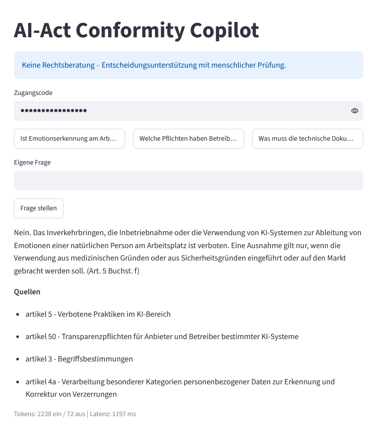
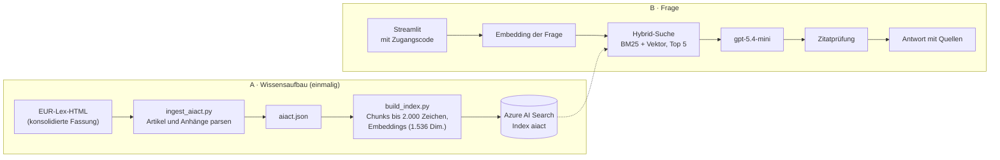

# AI-Act Conformity Copilot

Beantwortet Fragen zur EU-KI-Verordnung (AI Act) ausschließlich aus dem Gesetzestext, mit Belegstelle zu jeder Aussage und automatischer Prüfung der Zitate.

**Live-Demo:** https://ca-aiact-copilot.jollyglacier-8eb368d3.swedencentral.azurecontainerapps.io/ · Zugangscode auf Anfrage über [LinkedIn](https://www.linkedin.com/in/aleksej-weidemann)

Ab dem 2. Dezember 2027 gelten die Pflichten der EU-KI-Verordnung für Hochrisiko-KI-Systeme nach Anhang III. Der Gesetzestext ist lang, voller Querverweise und wurde 2026 durch den Digital Omnibus geändert. Der Copilot beantwortet Fragen dazu nur aus dem Gesetzestext und nennt zu jeder Aussage die Fundstelle. Findet er keine Grundlage, sagt er das offen, statt zu raten.

**English summary:** A retrieval-augmented question-answering app for the EU AI Act that answers only from retrieved excerpts of the consolidated regulation and cites the article or annex for every statement. Citations are checked against the retrieved sources, and questions outside the excerpts receive a fixed refusal instead of a guess.



## Was es kann

- Fragen zur KI-Verordnung beantworten, per Beispielfrage oder freier Eingabe.
- Nur aus den gefundenen Auszügen antworten, nicht aus dem Vorwissen des Modells.
- Jede Aussage mit Artikel oder Anhang belegen, z. B. „(Art. 26 Abs. 5)“ oder „(Anhang IV)“.
- Warnen, wenn die Antwort einen Artikel oder Anhang zitiert, der nicht unter den Quellen ist.
- Bei Fragen außerhalb des Gesetzestexts mit einem festen Satz ablehnen und keine Quellen anzeigen.

## Architektur



Die Volltextsuche nutzt den deutschen Analyzer `de.microsoft`, die Vektorsuche einen HNSW-Index. Beide Ergebnislisten werden per Reciprocal Rank Fusion zusammengeführt. Die RAG-Kette steht in `src/rag.py` und kommt ohne Framework aus.

| Komponente | Dienst | Region |
|---|---|---|
| Sprachmodell und Embeddings | Azure OpenAI (Data Zone Standard EU) | Sweden Central |
| Suchindex | Azure AI Search (Free) | France Central |
| App | Azure Container Apps (Scale-to-Zero) | Sweden Central |

## Qualität und Sicherheit

- **58 automatisierte Tests** (`python -m pytest -q`). Die Unit-Tests nutzen Fake-Clients und rufen kein Azure auf.
- **Separater Smoke-Test** gegen Azure (`python src/smoke_test.py`). Er prüft Chat, Embedding und Suche mit echten Aufrufen.
- **Zitatprüfung:** Jedes Belegzitat in Klammern wird mit den gefundenen Quellen abgeglichen. Bei einem Zitat ohne passende Quelle erscheint eine Warnung.
- **Fester Ablehnungssatz:** „Dazu enthalten die Auszüge keine Angaben.“ Die App erkennt ihn und zeigt dann keine Quellenliste.
- **Prompt-Injection:** Die Auszüge stehen abgegrenzt in `<auszuege>`. Eine Regel im System-Prompt weist an, sie als Daten zu behandeln und nicht als Anweisung. Das senkt das Risiko, schließt es aber nicht aus.
- **Fehlermeldungen** werden vor der Anzeige von Keys, Endpunkten und Hostnamen bereinigt.
- **Zugangscode:** Er wird in konstanter Zeit verglichen (`hmac.compare_digest`). Fehlt er in der Konfiguration, startet die App nicht (fail closed).
- **Kostenschutz in mehreren Stufen:** Zugangscode, höchstens 20 Fragen pro Sitzung, Ratenlimit am Modell-Deployment, höchstens ein Replikat, Budget-Alarm im Azure-Abonnement.
- **Container:** Die App läuft ohne Root-Rechte. `.env` ist per `.dockerignore` vom Build ausgeschlossen.
- **Secrets:** Keys und Zugangscode liegen als Container-Apps-Secrets vor, nicht im Image. Der Zugangscode wurde bereits einmal ohne neuen Build rotiert.

## Kennzahlen

Gemessen am 20.10.2026 in der Live-App.

| Frage | Tokens ein | Tokens aus | Latenz |
|---|---:|---:|---:|
| Emotionserkennung am Arbeitsplatz | 2.238 | 76 | 1,9 s |
| Pflichten der Betreiber | 1.744 | 612 | 3,7 s |
| Technische Dokumentation | 1.605 | 565 | 3,4 s |
| Mehrwertsteuer (außerhalb des Themas, Ablehnung) | 2.428 | 12 | 1,1 s |

Einzelmessung je Frage; Ausgabe-Tokens und Latenz schwanken zwischen Läufen.

Der Großteil der Tokens ist Eingabe-Kontext (die Auszüge). Die Zahl der Auszüge ist deshalb der größte Kostenhebel.

## Bewusste Entscheidungen

| Entscheidung | Begründung |
|---|---|
| Feste RAG-Kette statt autonomem Agenten | Jede Frage durchläuft dieselben Schritte. Das Verhalten ist nachvollziehbar und testbar. Die Kosten sind planbar. Ein Agent bringt bei dieser Aufgabe keinen Mehrwert. |
| Kein LangChain | Jede Stufe ist eigener, lesbarer Code. Es gibt weniger Abhängigkeiten. Tests und Fehlersuche sind einfacher. |
| Hybrid-Suche statt nur Vektorsuche | Die Vektorsuche findet Inhalte mit ähnlicher Bedeutung. Die Volltextsuche findet exakte Begriffe und Nummern wie „Art. 50“. Die Kombination deckt beide Fälle ab. |
| Zitatprüfung nur für Zitate in Klammern | Präzision geht vor Vollständigkeit. Querverweise im Fließtext erzeugten Fehlalarme. Zitate ohne Klammern bleiben deshalb ungeprüft. |
| Ablehnung statt Raten | Bei Rechtsfragen ist eine falsche Antwort schlimmer als keine. Ohne passende Auszüge antwortet die App mit einem festen Satz. |
| Scale-to-Zero | Ohne Nutzung entstehen keine Rechenkosten. Dafür dauert der erste Aufruf nach einer Pause länger. |
| Zugangscode als Kostenschutz | Jede Frage verbraucht Tokens und kostet Geld. Ein offener Zugang wäre ein unbegrenztes Kostenrisiko. |

**Noch nicht enthalten:**

- Risikoklassifizierung und Gap-Analyse gegen Anhang IV
- Upload eigener Dokumente
- Managed Identity statt API-Keys
- Golden Set mit automatischer Bewertung

## Wie es gebaut wurde

Ich habe das Projekt mit einem Coding-Agenten gebaut (Claude Code). Den System-Prompt, die Anzeige der Antwort (`zeige_antwort`) und die Zitatprüfung (`pruefe_zitate`) habe ich selbst geschrieben. Den übrigen Code hat der Agent geschrieben. Jede Änderung habe ich vor dem Push geprüft.

Die Regeln für den Agenten stehen in `CLAUDE.md`. Er liest keine Secrets, löscht keine Azure-Ressourcen und committet nur lokal. Den Push mache ich selbst nach dem Review.

Die Azure-Ressourcen habe ich selbst angelegt und die App selbst deployt. Fachliche Angaben habe ich stichprobenartig gegen den Text auf EUR-Lex geprüft.

## Rechtsgrundlage

Verordnung (EU) 2024/1689 (KI-Verordnung) in der konsolidierten Fassung vom 27.07.2026 (CELEX 02024R1689-20260727), abgerufen am 15.10.2026 von EUR-Lex. Eingearbeitet sind:

- M1: Verordnung (EU) 2026/1744 (Digital-Omnibus), ABl. L 1744 vom 24.07.2026
- C1: Berichtigung ABl. L 90802 vom 09.10.2025 (zu 2024/1689)
- C2: Berichtigung ABl. L 90810 vom 29.09.2026 (zu 2026/1744)

Konsolidierte Fassungen dienen der Dokumentation und haben keine Rechtswirkung. Rechtsverbindlich sind nur die im Amtsblatt veröffentlichten Rechtsakte. Details in `data/aiact/QUELLEN.md`.

## Lokal starten

Voraussetzung: Python 3.13 und Zugriff auf Azure OpenAI und Azure AI Search.

```
pip install -r requirements-dev.txt
cp .env.example .env    # Werte eintragen, inkl. APP_ZUGANGSCODE
pytest -q
streamlit run src/app.py
```

Für die App muss der Suchindex in Azure AI Search bestehen. Neu aufbauen lässt er sich mit `python src/build_index.py`.

## Haftungsausschluss

Keine Rechtsberatung – Entscheidungsunterstützung mit menschlicher Prüfung.
